# A7 – Linkage Mechanism

## Objective
Design, 3D print, and document a working linkage or mechanism that performs a defined motion or task.  

## Design  

I designed a small box with a lid attached to the box by a pin. The pin was designed to be forced into the box with a very small clearance where it wouldn't move, and to be a sliding fit where the lid connects, so that the lid could be rotated.  

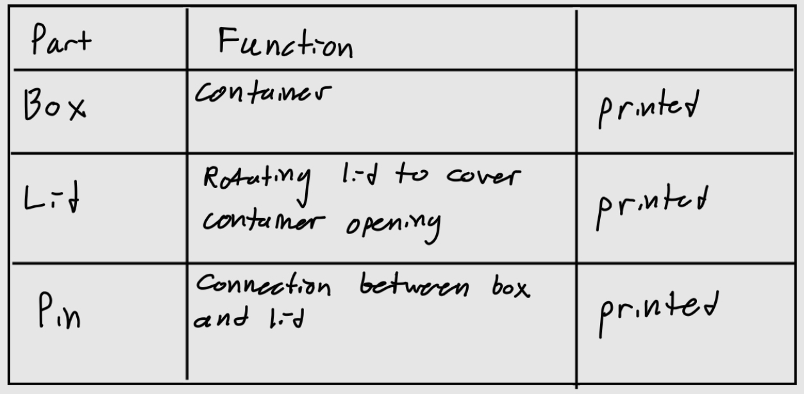 

**Decision #1:**  
The diameter of the pin and shaft is 0.3 in. The fit between the box and the pin is a LT 1 fit, where I used the tolerance of the H7 hole 0.6 thousandths of an inch to design the hole in the box. The tolerance of the shaft is -0.2 to +0.2 thousandths of an inch, so I just kept the modeled pin as 0.3 in. I considered other fits, but this one seemed to be a good choice for this material and function.  

   
 

**Decision #2:**  
For the lid, I wanted to make a running/sliding fit, but I decided not to use any of the RC fits to avoid complication. So I just gave the lid hole a 0.02 in clearance, and made a section of the pin 0.01 in less than the rest of the pin. Leaving a total clearance of 0.03 in. This gives plenty of room for the lid to rotate. To make sure the lid would not slip off I added a wider lip at the top.  

 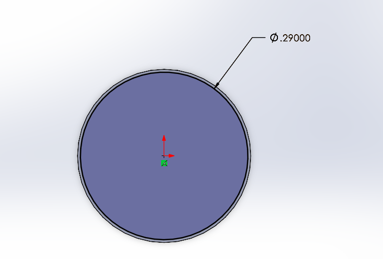  
 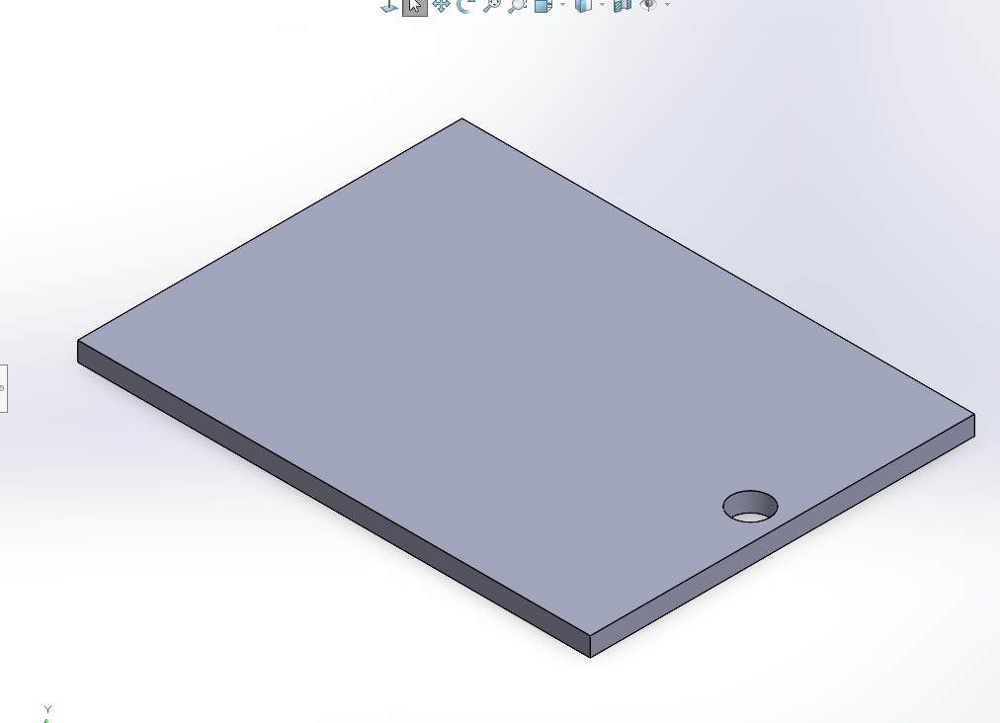  

**Decision #3:**  
I designed the lid and box to have no clearance between the two, so that they could stay closed due to friction. The other option was to add a part to clip the lid in place, but it would've required more time and likely supports that would've complicated the design.  

**Assembly**
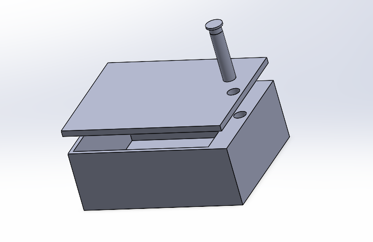  

To make sure that I had dimensioned correctly, which should've included no interference. I used the collisions tool in SolidWorks.  
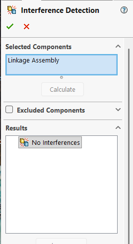  

## Print  

**Decision #1:**
I originally designed the box to be 3 in wide and 4 in long. But I realized that this would take very long to print, which would have caused difficulty if I needed to adjust the fit if it didn't work. So I scaled the print down by 50%. Since I designed with no interference, my original fit decisions wouldn't be much affected by this scaling.  

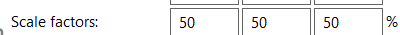  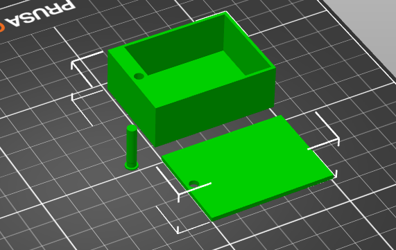  

As for PrusaSlicer settings, I kept the infill simple, also due to the size there wasn't much infill, the only force that would be applied to the box was when the pin would be forced in, so a 10% grid infill sufficed. I set the perimeters to 2. I set the layer height to 0.1mm to maintain accuracy around the hole.  

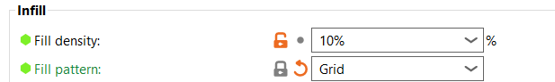 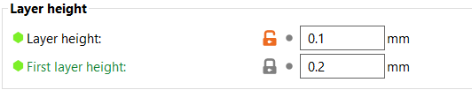  

**Decision #2:**  
With the orientation I used, the pin was placed so that the top lip of the pin would be on the bed. This achieved two goals, giving the print a large base to print on, and to prevent the need for an elephants foot because the dimensions of the lip did not affect the fit. Although this would have required supports around where the pin changes diameter. I could've increased the hole size on the lid or tried to print without the change in diameter of the pin, but I wanted to keep my design, so I tapered the ledge to prevent the need for supports.  

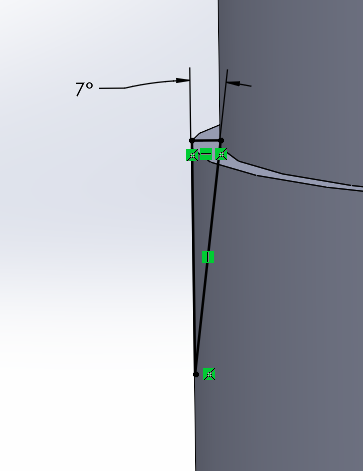  

**Decision #3:**  

I chose to use the PrusaSlicer seam tool to prevent seams from forming in the holes. This would improve the fit on both the box and lid.  

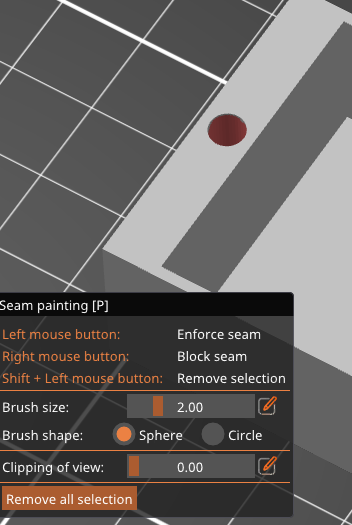 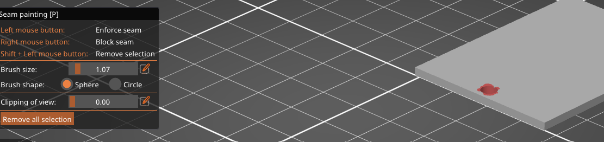  

## Lessons Learned  
This lab took about 6 hours. The research was likely 30 minutes, which was mostly researching fits from the Machinery's Handbook. The CAD modeling took about 2 hours. The slicing took about an hour, as I had to decide the proper scaling and learning and troubleshooting the seam tool. The print took about 2 hours, I had to do two because of the first had an error that prevented the fit from working, but it wasn't due to the design. The assembly and post-processing was quick, I had no supports and there was only one pin to fit.  

My biggest mistake was the size I originally modelled my part in. I did not properly consider print times and should've scaled it down before I got to the PrusaSlicer, to maintain the accuracy of the fit.  

My first print clearance worked fine. Although after using the part I realized I should've made the clearance between the box and pin smaller. When I drop the part too hard the pin comes out slightly, it isn't a larger flaw, but I would've wanted it to be a tighter, more resilient fit.  

