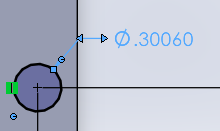
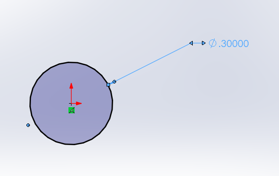
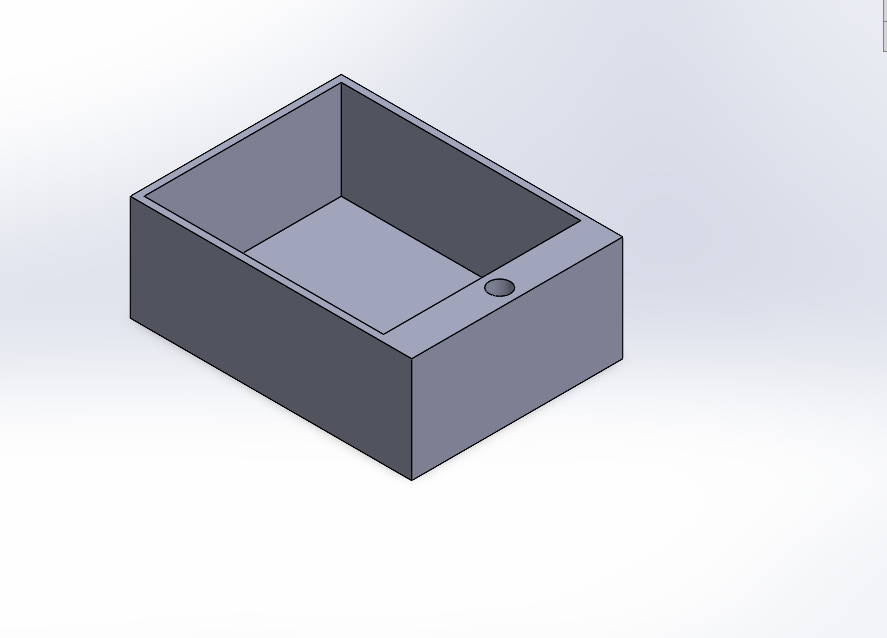
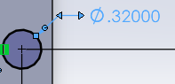
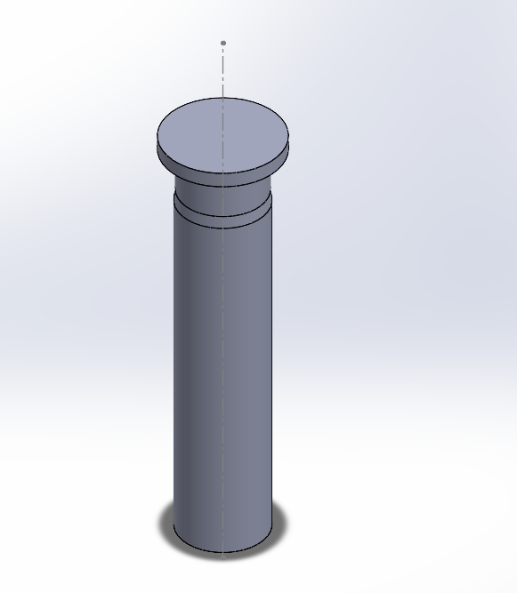

# A7 – Linkage Mechanism

## Objective
Design, 3D print, and document a working linkage or mechanism that performs a defined motion or task.  

## Design  

I designed a small box with a lid attached to the box by a pin. The pin was designed to be forced into the box with a very small clearance where it wouldn't move, and to be a sliding fit where the lid connects, so that the lid could be rotated.  

**Decision #1:**  
The diameter of the pin and shaft is 0.3 in. The fit between the box and the pin is a LT 1 fit, where I used the tolerance of the H7 hole 0.6 thousandths of an inch to design the hole in the box. The tolerance of the shaft is -0.2 to +0.2 thousandths of an inch, so I just kept the modeled pin as 0.3 in. I considered other fits, but this one seemed to be a good choice for this material and function.  

   
 

**Decision #2**  
For the lid, I wanted to make a running/sliding fit, but I decided not to use any of the RC fits to avoid complication. So I just gave the lid hole a 0.02 in clearance, and made a section of the pin 0.01 in less than the rest of the pin. Leaving a total clearance of 0.03 in. This gives plenty of room for the lid to rotate. To make sure the lid would not slip off I added a wider lip at the top.  

   
 

## Decide

## Communicate

