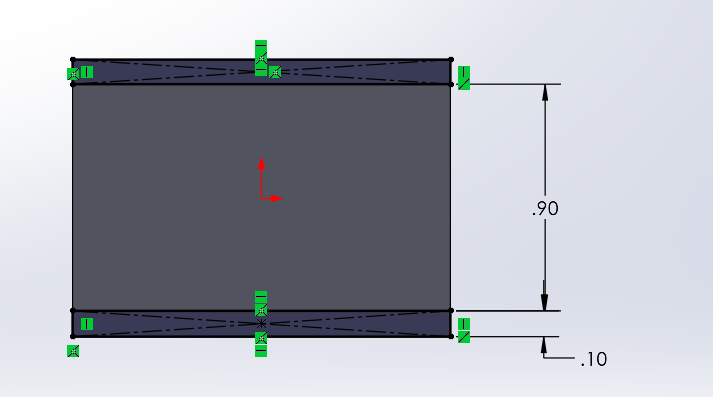

# A8 – Design Something Useful

## Objective
Use what you have learned thus far to design and 3D print something useful and or functional. 
 

## Problem Statement

Many vehicles have a compartment to hold glasses, mine and many other cars do not have that feature. I don't wear glasses everyday but I need them to drive at night safely, so I usually keep them in my car. However, I don't have a good spot to put them and they often end up being dropped around my car, and this problem most recently caused some minor damage to my glasses. So I am designing a small piece that clips onto the sun visor and can hold my glasses in place from the middle, that way they will not get lost and are easy to access. This product can be used by anybody with a car who wears either prescription or sunglasses, which is most people. I'm approaching this design around this ability for it to be functional for anyone, I am not designing it with exact specification to my glasses or sun visor. However I did use them for basic dimensions.

## Design

To begin, I used a caliper to get the approximate dimensions of my sun visor and the width of the bridge of my glasses. I decided that the holder should be a thin curved extension that the glasses are slid into from the nose bridge between the lenses. The curvature will prevent the glasses from falling out on their own. 

The clip was to be a little over an inch in height in total, with the arms being 0.1 in, leaving 0.9in for the gap to fit the visor. I was only able to get an approximation of the dimension of the visor using a similarly sized object, but 0.9in should be slightly smaller, making a sort of interference fit to keep the clip on. This works because sun visors are usually made of a compressive material that will work well for this fit.  

  

  

## Communicate

