# A8 – Design Something Useful

## Objective
Use what you have learned thus far to design and 3D print something useful and or functional. 

## Design Question  

Asking smart questions matters for multiple reasons. They encourage learning, and asking the right questions can allow someone to think more creatively and critically about what matters in a design. This is to gain by both the person asking the question and the person being asked. It is a great way of working through a problem with a team, besides simply thinking through options that come to mind, asking questions to a team allows everyone to think of the issue in other ways.  

## Problem Statement

Many vehicles have a compartment to hold glasses, mine and many other cars do not have that feature. I don't wear glasses everyday but I need them to drive at night safely, so I usually keep them in my car. However, I don't have a good spot to put them and they often end up being dropped around my car, and this problem most recently caused some minor damage to my glasses. So I am designing a small piece that clips onto the sun visor and can hold my glasses in place from the middle, that way they will not get lost and are easy to access. This product can be used by anybody with a car who wears either prescription or sunglasses, which is most people. I'm approaching this design around this ability for it to be functional for anyone, I am not designing it with exact specification to my glasses or sun visor. However I did use them for basic dimensions.

## Design 

I made an initial sketch of how I wanted the clip to work and how it would fit onto the visor.  

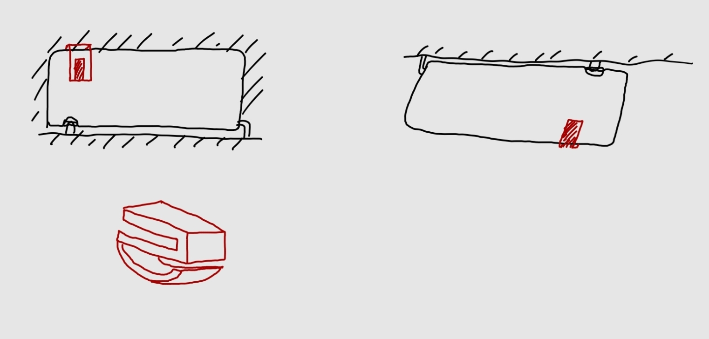  

To begin, I used a caliper to get the approximate dimensions of my sun visor and the width of the bridge of my glasses. I decided that the holder should be a thin curved extension that the glasses are slid into from the nose bridge between the lenses. The curvature will prevent the glasses from falling out on their own. 

The clip was to be a little over an inch in height in total, with the arms being 0.1 in, leaving 0.9in for the gap to fit the visor. I was only able to get an approximation of the dimension of the visor using a similarly sized object, but 0.9in should be slightly smaller, making a sort of interference fit to keep the clip on. This works because sun visors are usually made of a compressive material that will work well for this fit.  

  

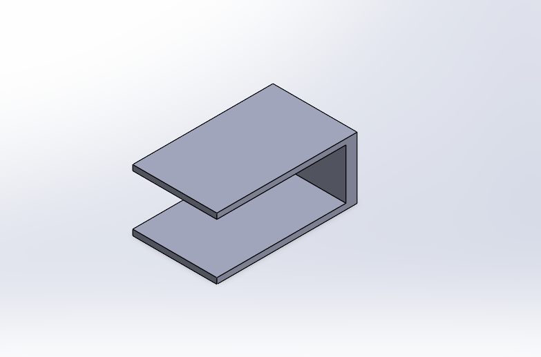  

I then added the extension for the holder of the glasses, I made the width of the extension slightly smaller than the width of the bridge of my glasses. I did not want the holder to bend or interfere with the nose cushions on my glasses.  

I made the curved extension out of an oval which I then cut in half and added extra material at the support. I chose this shape to prevent the glasses from sliding out while the car was moving but wasn't difficult to slip the glasses in.  

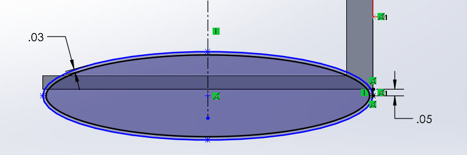 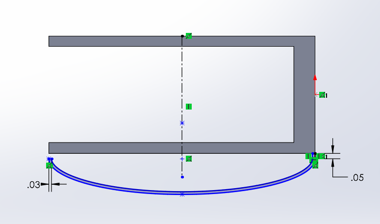  

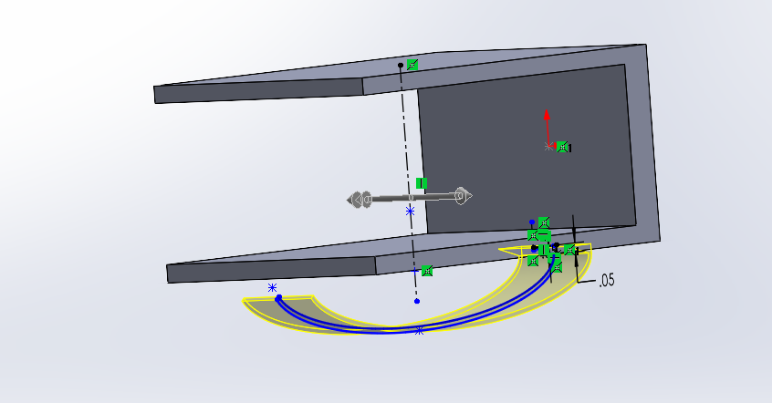  

After my original print, I realized that this holder was way too thin to support the weight of the glasses, and my biggest mistake during this was not noticing this either in SolidWorks or Prusa. In Prusa the holder was only a single filament thick, and I should have figured that wouldn't work.  

So after my first print failed, I redesigned the holder to be thicker. 

I also added fillets at the end of the holder to avoid any snag on the glasses. I added on on the ends of the arms to make it easier to slide onto the visor. Then I added them between the arms and the backing to avoid stress and deformation when the arms bend.  

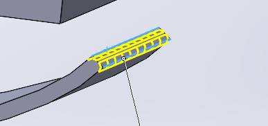 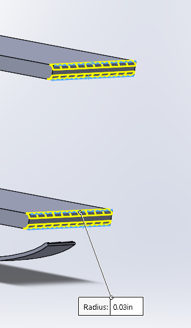 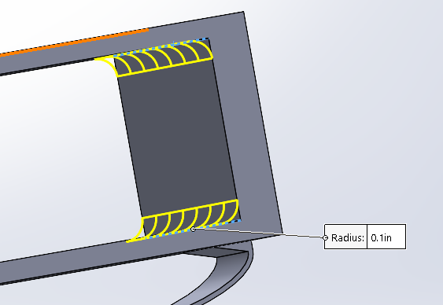  

I then added a gap between the arms connection to improve the capacity to bend.  

My final design with the improved holder:  

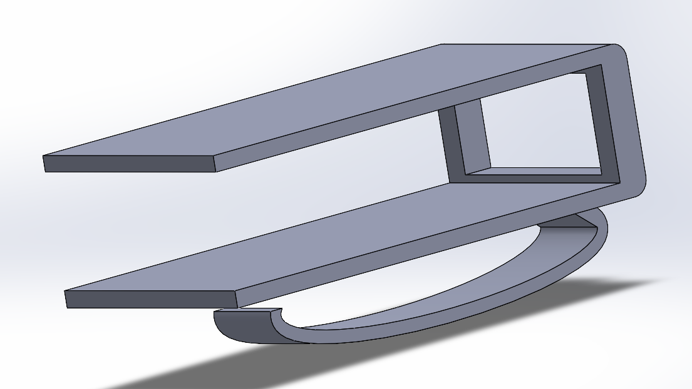  

## 3D Print  

In the preprocessor, I chose pretty typical settings. I used 2 perimeter wall thickness, and a 15% rectilinear infill. All the parts of the clip were thin and didn't use that much infill if at all, so I figured increasing it wouldn't impact the function much, I realized this was a small mistake later. I chose rectilinear some what arbitrarily, the arms were too thin for the shape to appear. I used a layer height of 0.15mm, which is default, there were no high precision parts necessary so I did not change it. 

  
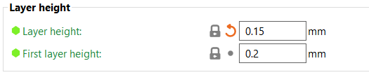  

I had to use supports for the holder and the gap in the backing. I first used snug supports but I realized they would be difficult to remove from the the gap. So I used organic supports automatically generated, but they did not automatically print on the gap, so I used paint-on support.  

 
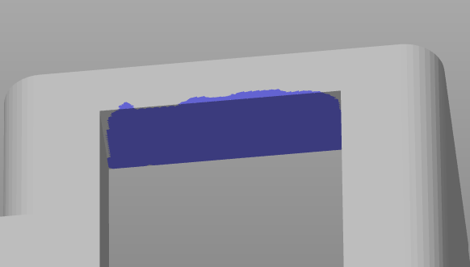  
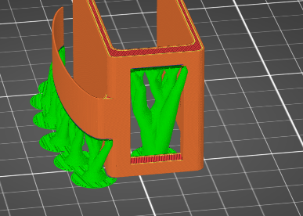  

I used small wire snips to remove the supports.  

For the layout of the build orientation, I placed it on its side, this was to increase strength over printing it on the back. It would've been stronger if I printed it on the side opposite the holder, but this would've required a lot of supports, which would've been harder to remove and decrease the surface finish.  

The build volume:  

  

Video of print:  

https://drive.google.com/file/d/197EQusEHATLIltqjYXXcsOxL7xkJv0MU/view?usp=sharing  

The part in action:  

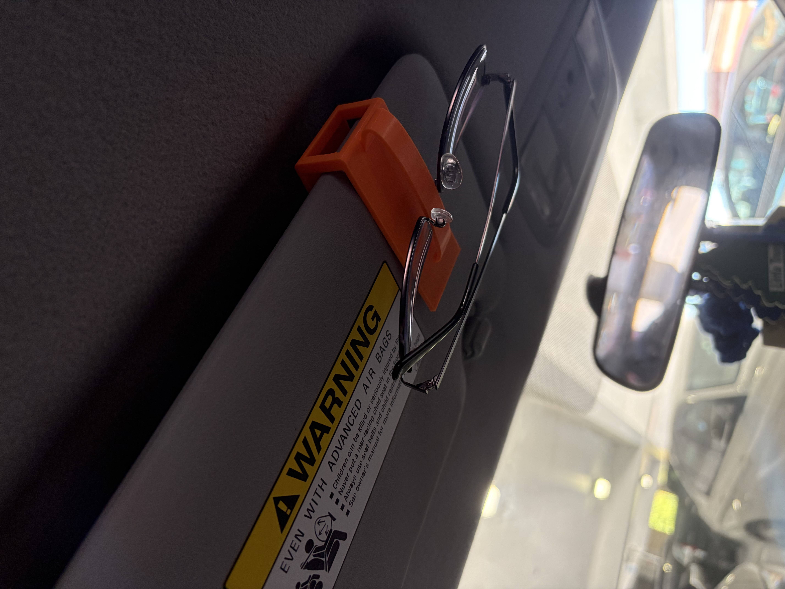  

## Lessons Learned  

A mistake I made was not considering for plastic deformation in the compression of the the clip onto the visor, after using the part for a few days, the arms had become permanently deformed. I should have either made the arms or backing thicker, or not used the gap in the back. More perimeters may also have helped. I do not think changing they infill would've had much impact because there wasn't much infill being used.  

This design took about 6-8 hours from start to finish.  

## Communicate

