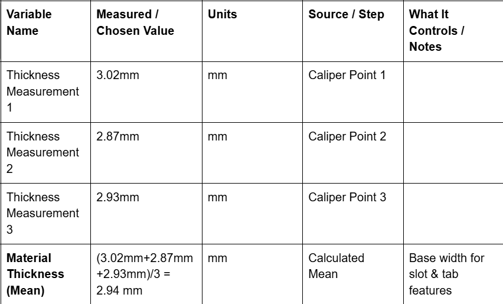

# A9 – Laser Cutter

## Design

For my teammate Saniyah and I's design, we decided to make a small model house that can be easily constructed and deconstructed. We wanted it to have four walls, two roof panels that met in a peak, and a bar that connects the front and back to add stability.  

Before we designed, we made test coupons to measure kerf. We also got three measurements for the thickness of the board in different places to calculate an average thickness. First we made a square of nominal width and base of 20mm and then a comb-like shape with three different gap widths based on the measured thickness of the test square to test the fit between them.  

  
  
  

We found the kerf to be about 0.1mm.  

We used the kerf measurement to make the gaps of the test fit coupon.  

  
   
  

## Manufacturing  

## Lessons Learned

