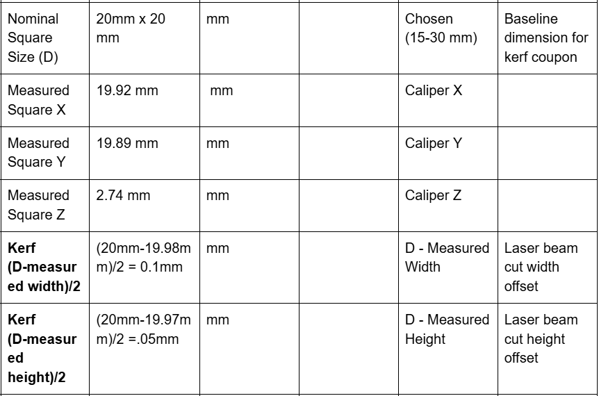
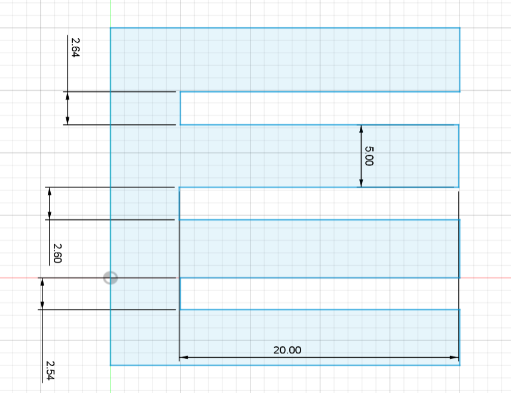
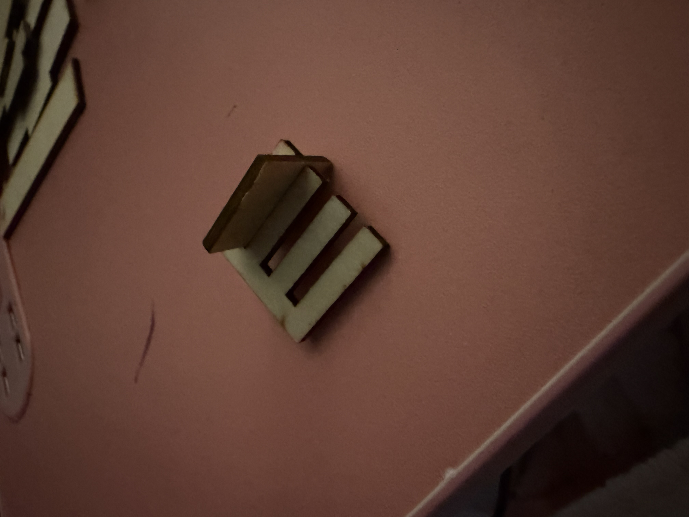

# A9 – Laser Cutter

## Design

For my teammate Saniyah and I's design, we decided to make a small model house that can be easily constructed and deconstructed. We wanted it to have four walls, two roof panels that met in a peak, and a bar that connects the front and back to add stability.  

Before we designed, we made test coupons to measure kerf. We also got three measurements for the thickness of the board in different places to calculate an average thickness. First we made a square of nominal width and base of 20mm and then a comb-like shape with three different gap widths based on the measured thickness (2.74mm) of the test square to test the fit between them.  

  
  
  

We found the kerf to be about 0.1mm.  

We used the kerf measurement to make the gaps of the test fit coupon.  

  
   

We found the 2.54mm gap to be the best fit, which aligned with our measured kerf.  

From there we began designing the parts to our house build, the walls and floor we decided to be 75mm x 75mm squares with notches of equal length on each end that would match with the other walls. We decided the roof should have more notches because they would be positioned at an angle need more security. Something we initially overlooked was making the floor notches the same depth as all the other notches. So in another version we made the floor notches the nominal thickness of the board plus a kerf clearance so that the notches would be flush with the floor.  

**Walls:**  
  
  

## Manufacturing  

## Lessons Learned

