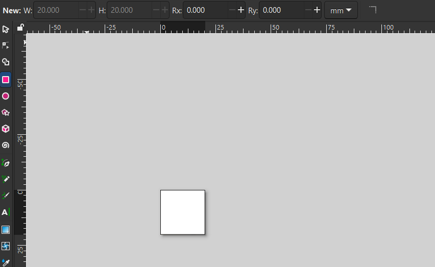
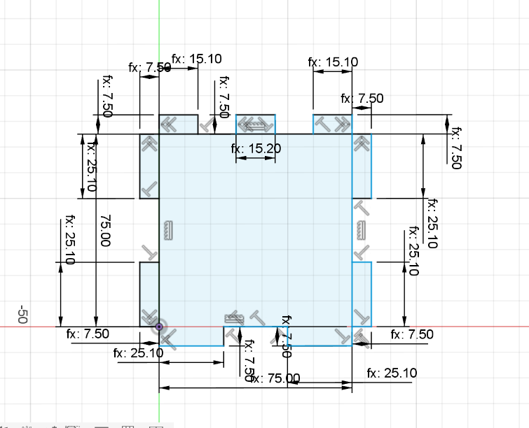
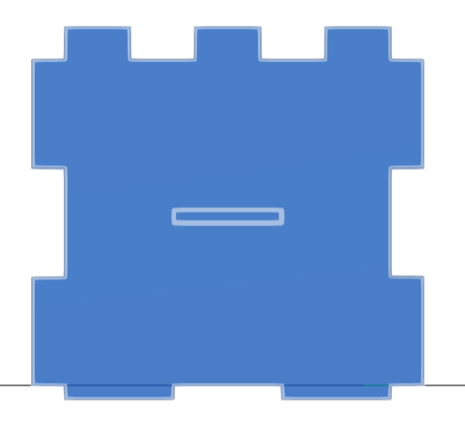
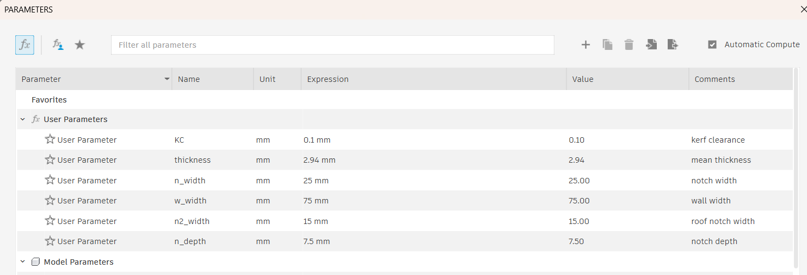
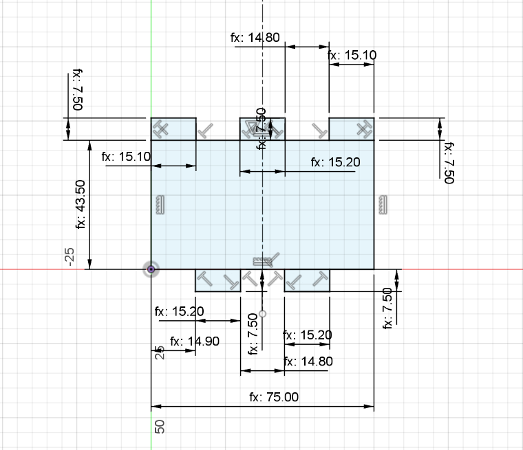
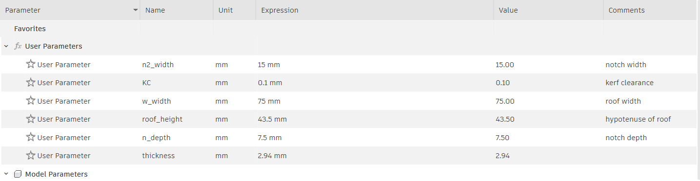
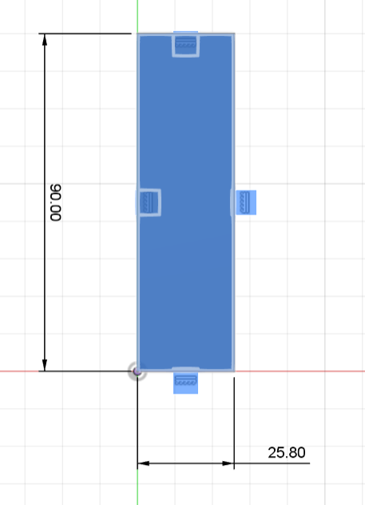
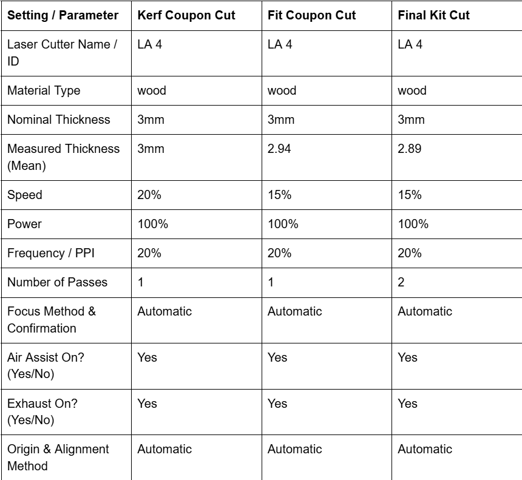
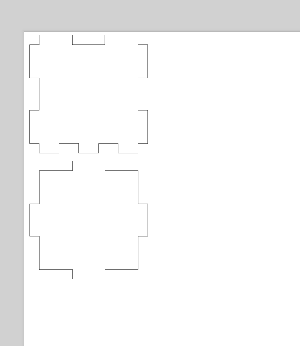
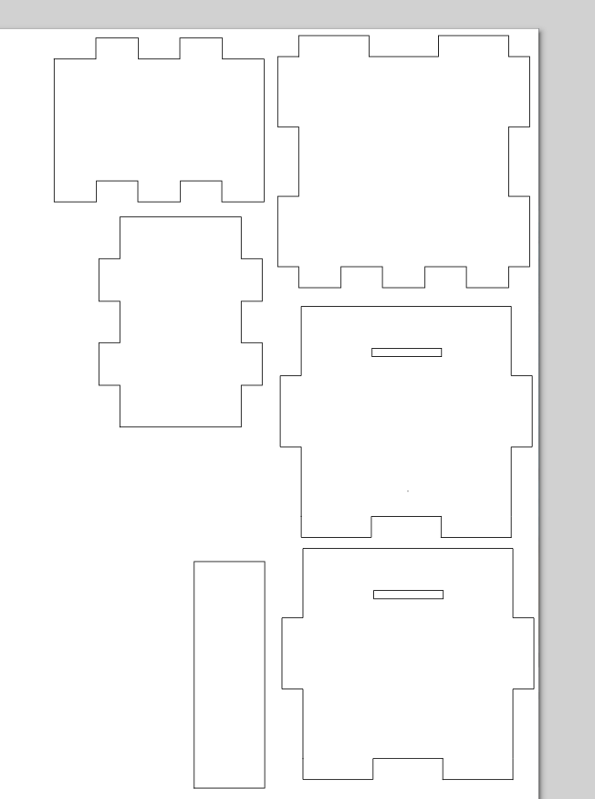

# A9 – Laser Cutter

## Design

For my teammate Saniyah and I's design, we decided to make a small model house that can be easily constructed and deconstructed. We wanted it to have four walls, two roof panels that met in a peak, and a bar that connects the front and back to add stability.  

Before we designed, we made test coupons to measure kerf. We also got three measurements for the thickness of the board in different places to calculate an average thickness. First we made a square of nominal width and base of 20mm and then a comb-like shape with three different gap widths based on the measured thickness (2.74mm) of the test square to test the fit between them.  

  
  
  

We found the kerf to be about 0.1mm.  

We used the kerf measurement to make the gaps of the test fit coupon.  

  
   

We found the 2.54mm gap to be the best fit, which aligned with our measured kerf.  

From there we began designing the parts to our house build, the walls and floor we decided to be 75mm x 75mm squares with notches of equal length on each end that would match with the other walls. We decided the roof should have more notches because they would be positioned at an angle need more security. Something we initially overlooked was making the floor notches the same depth as all the other notches. So in another version we made the floor notches the nominal thickness of the board plus a kerf clearance so that the notches would be flush with the floor.  

**Walls:**  
  
  
  
The second photo has the revised floor pegs.  

**Roof:**  
  
  

**Connection Bar:**  
  

## Manufacturing  
### Research 
Laser cutting works by using C02 and exciting it with electrons and focusing that released energy from instable C02 into photons. The photons are foucused with mirrors to create a strong laser. It terms of cost, it depends on the application whether it is more affordable to FDM or laser cut, for long sheets of continous material, laser cutting is both cheaper, faster, and more feasible. If you want a 3D model with discrete details, FDM makes more sense for cost and material options.  

### Laser Process Record  
  

### Video of Cutting  

### Kerf of Coupon and Fit Test  

We had to kerf tests, one with more power on the laser for the 1/4" wood setting, which is the one with more char.  

### Cutting process and results  

For the first test kerf coupon, we used the cut settings for 1/4" wood from a recommendation from a peer, this was because on previous tries, the laser would not cut through the 3mm wood all the way. This resulted in poor edge quality and lots of char. We later solved this problem by making the laser complete two passes instead of one.  

In inkscape, we first made a test print to do to ensure that two parts would fit together like we planned.  
  

Then we printed the rest of the parts as one layout.  
  

## Lessons Learned

