# L10- RC2 Sliding Fit

## Research and Planning  

I chose a 0.3 in nominal hole size for my fit. The tolerance range is 0.0002-0.00085in for that nominal size.  

**Hand Sketch:**  

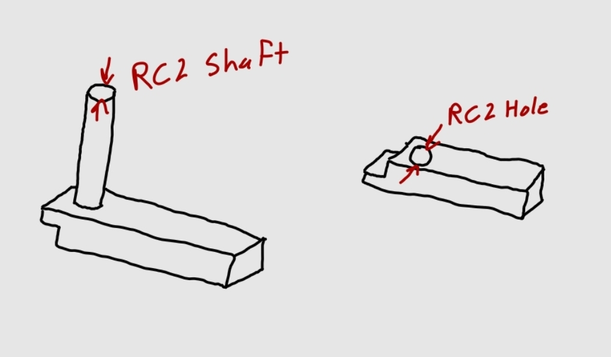  

RC2 fits are used in many applications. Like automotive components for shafts and bearings without friction or machinery like conveyor belt systems that need to turn easily but not move freely in and out. Any application that allows free turning but not excessive assembly and disassembly.  

In my research I found that resin prints always shrink, and by different amounts depending on the prints size, the resin used and the printer. This means that it makes the most sense to represent shrinkage as a percentage. My resource used trial squares and measuring averages and the shrinkage offset, and they found that a factor of 0.96% should be used.  

## CAD Design  

Before I began modeling, I wanted to confirm the shrinkage with a test square in the printer. I found that the part actually expanded by 5%. This was confusing but I thought it may have been something to do with the clear resin, but it may have also been that I did not cure it long enough because this ended up being an error. However I used this 5% expansion in my design, since this means I made the hole clearance larger than necessary it actually worked out for the best.  

For my design, I decided to make a small tool that can be used to take measurements of items that can't be reached with a caliper. Meaning this print can be pressed onto something and stay in that position due to the RC2 fit, and then be measured with the caliper in that somethings place.  

I used 0.3in for a nominal size, and applied the RC2 tolerances from the machinery's handbook to the hole and shaft. Those being 0.0004in for the hole and 0.00085in for the shaft. Then I added a percentage multiplier of 0.95 or 5% decrease to account for expansion. 

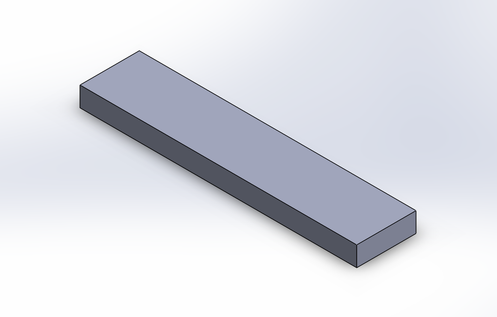  
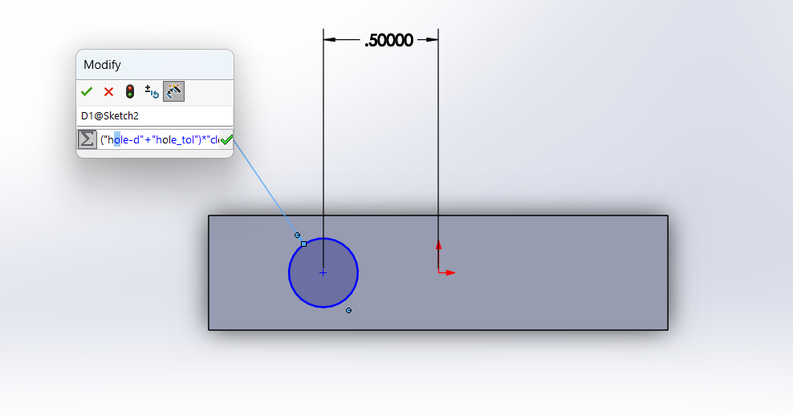  
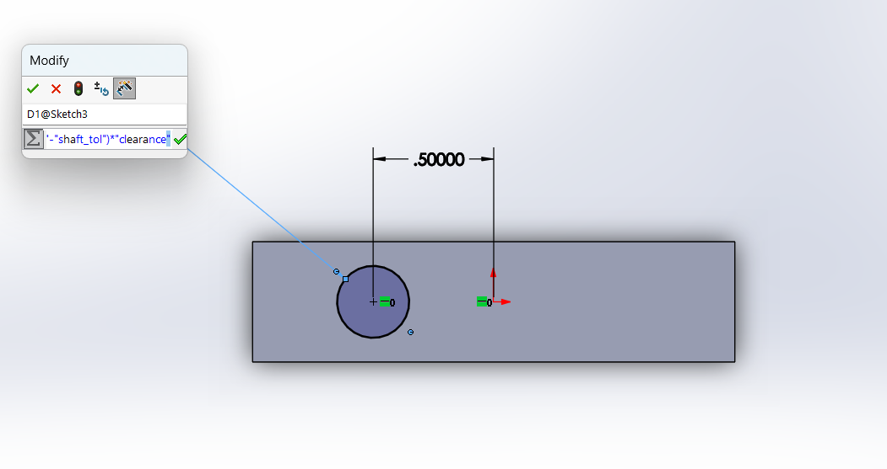  
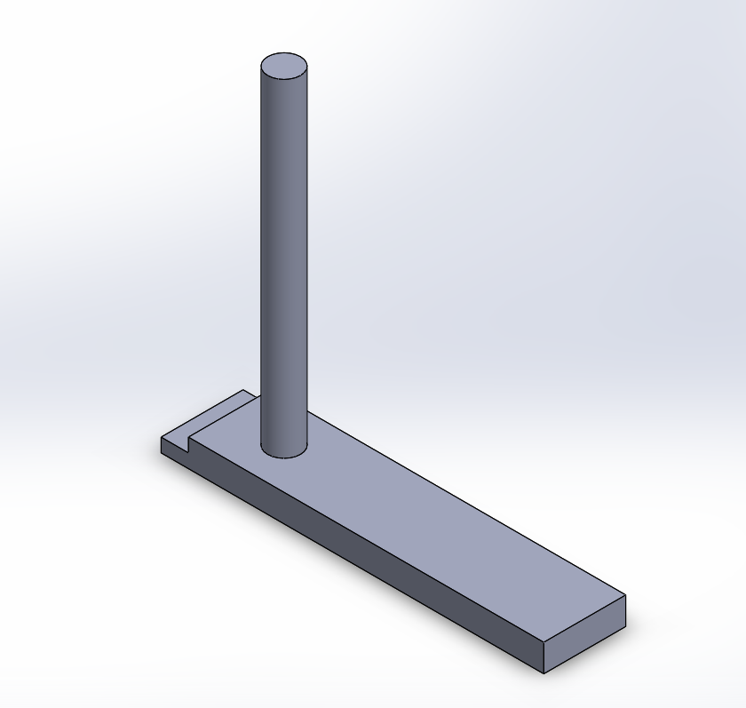  
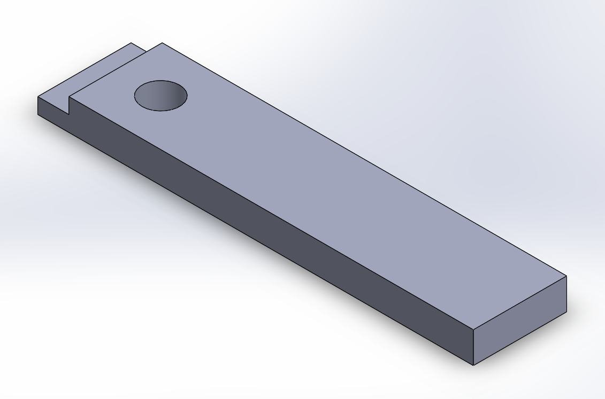  
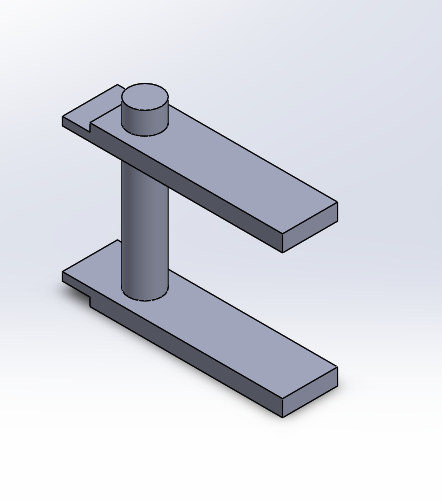  

The hole and shaft, although I should've accounted for shrinkage instead of expansion achieved a better fit this way than if I had accounted for shrinkage. I believe if I had accounted for shrinkage it wouldn't have been able to fit with just the machinery's handbook fit tolerances.  

## Preprocessing for 3D Printing  

For the preform preprocessing I used the one-click auto orientation and supports and they ended up producing a print with little errors, although there ended up being a small amount of warping on the shaft.  

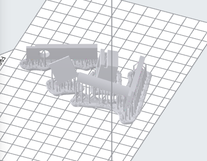  
  
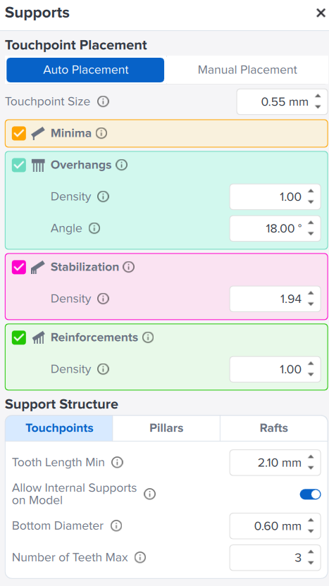  
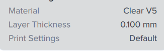  
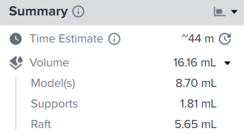  

## Post-Processing  

The print came out well the first time, and the supports were easy to remove but left a lot of small pieces from the touchpoints that I had to scrape off.  

I washed the print for five minutes and cured it for ten minutes.  

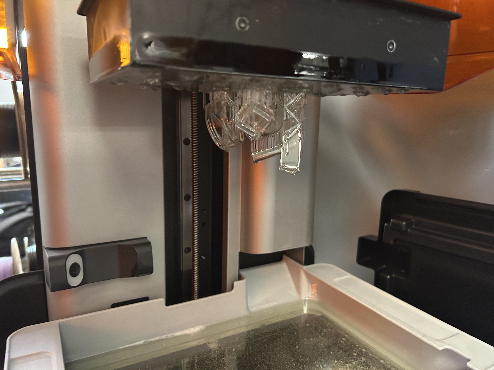  
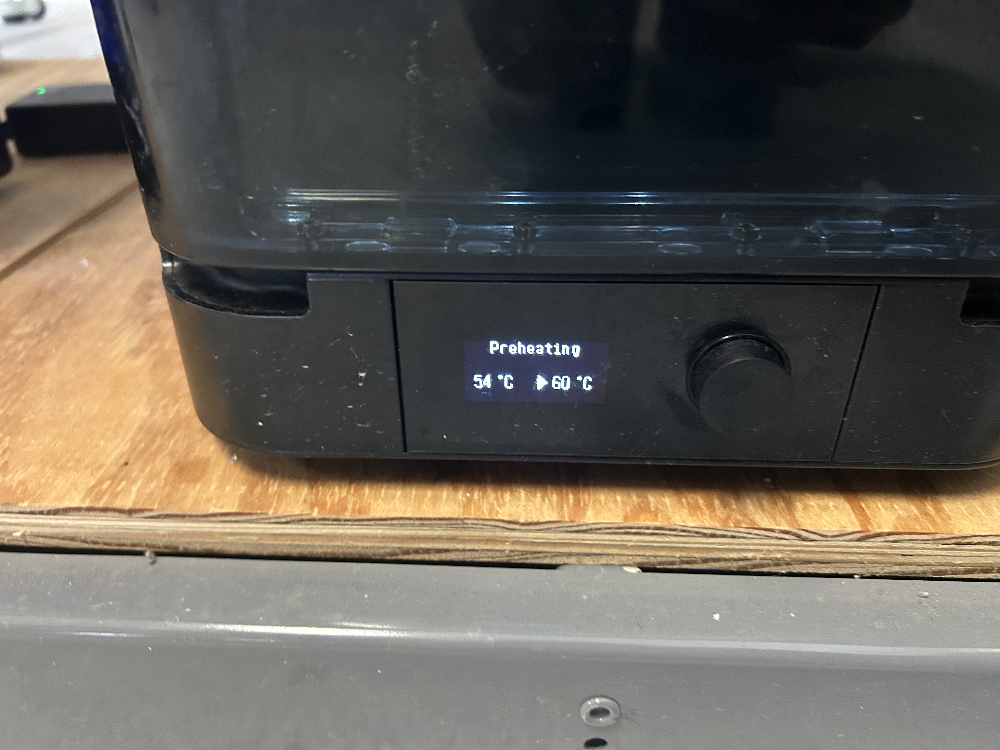  
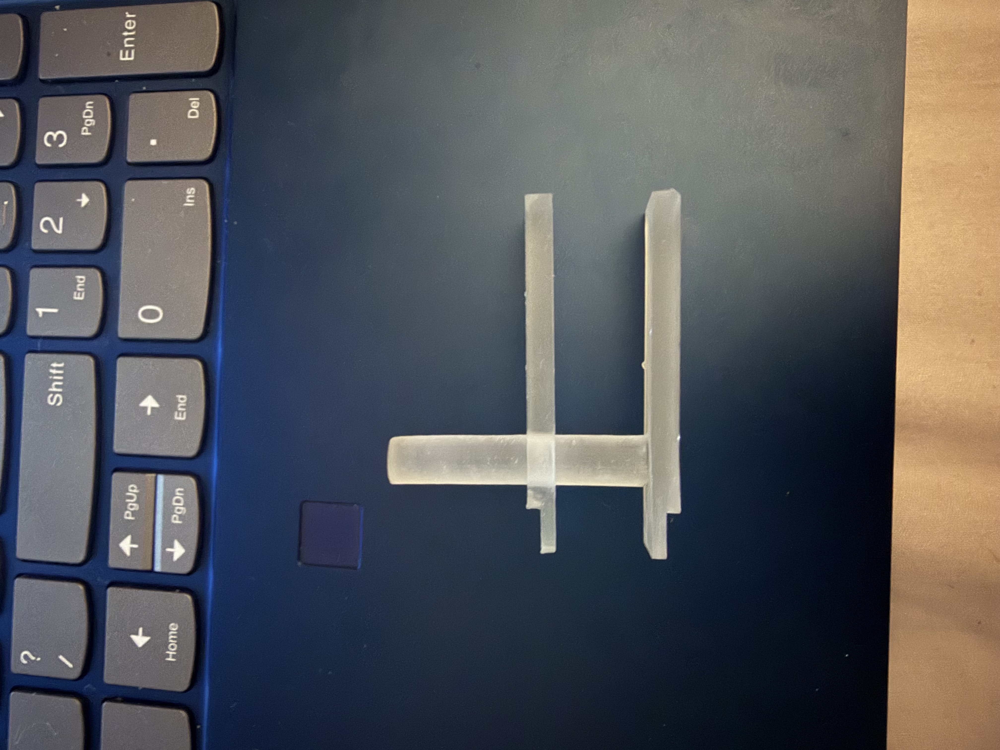  

The surface finish was dusty at first when I first used the sliding fit, but after some wiping with a towel it achieved a mostly smooth surface finish. The accuracy was quite accurate, the parts slide somewhat ease and stayed in place. There was one part of the shaft that had a warped bump which was difficult to slide across. The parts slid better after curing.  

## Lessons Learned  

The challenges that arose achieving a proper RC2 fit was the SLA printing process and the factor of shrinkage. Since my test fit got confusing results I used an incorrect factor for expansion. This still resulted in a functional fit, but it wasn't technically a RC2 fit.  

Curing improved the fit, and the surface roughness made it harder to move the hole across the shaft at points. To improve the accuracy next time, I want to cure the parts longer, and make a tighter clearance to properly account for shrinkage, this would result in a more accurate RC2 fit.  

**Resources:**  
Machinery's Handbook  
https://mechcodex.com/reference/ansi-standard-fits  
https://www.liqcreate.com/supportarticles/resin-shrinkage-compensation/  

