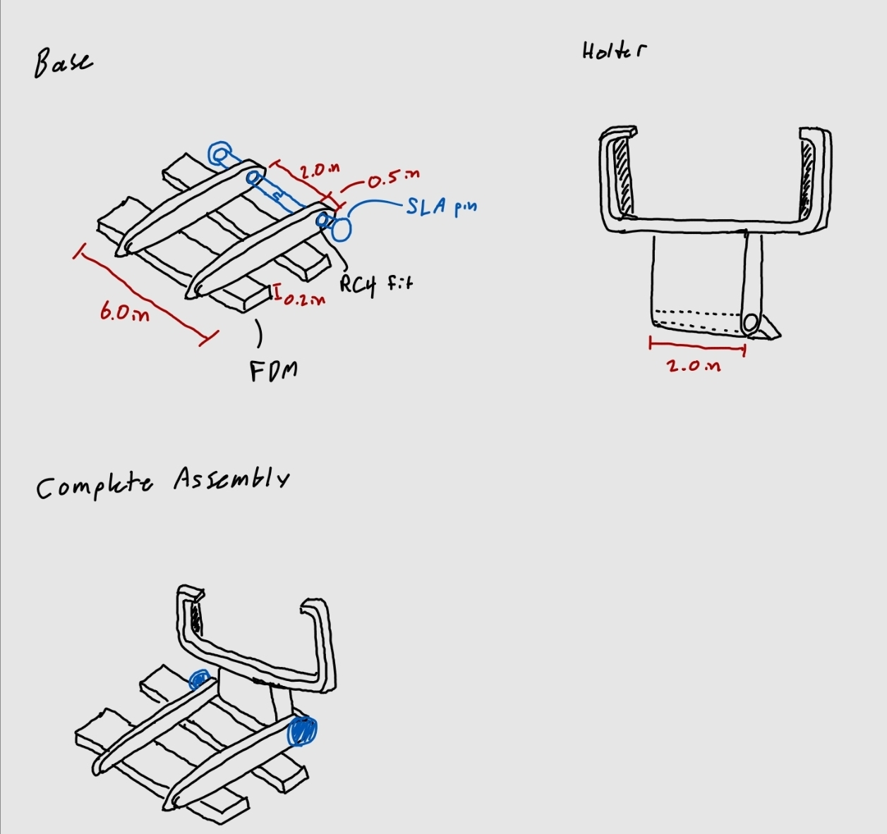
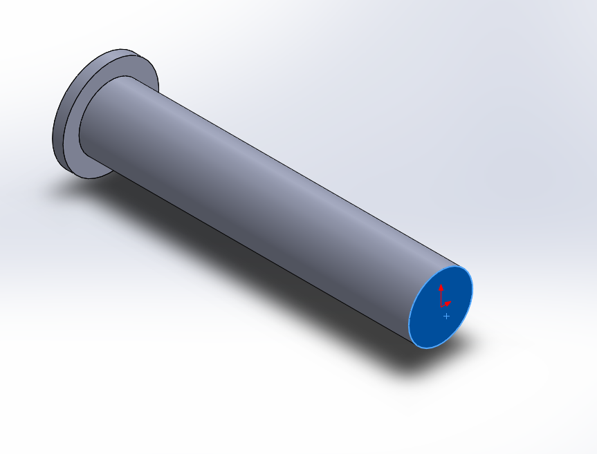
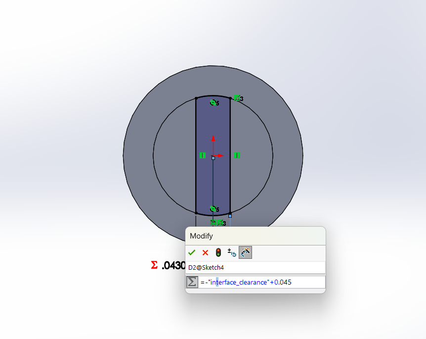
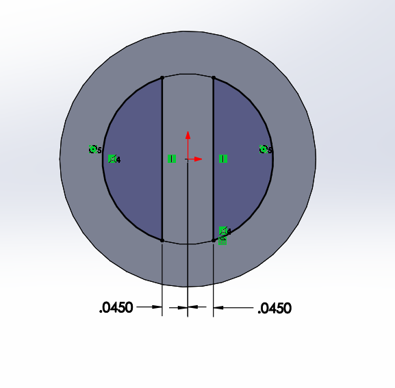
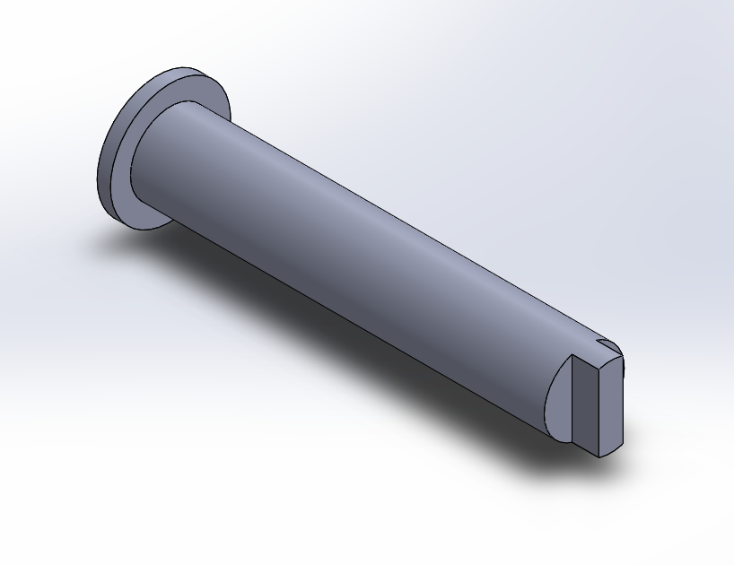
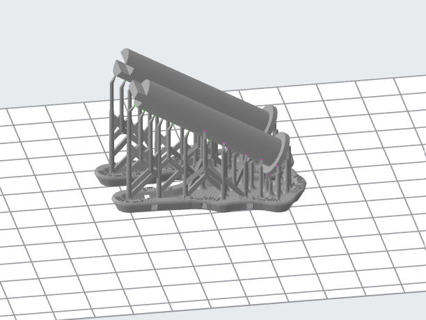
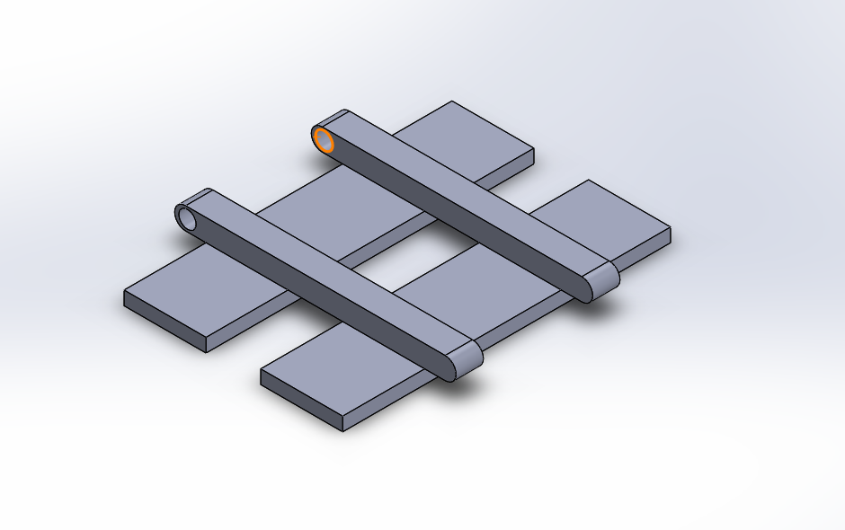
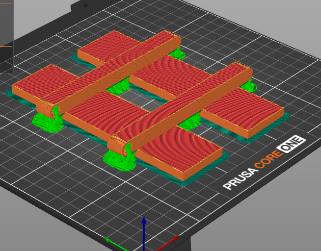

# Final Project – Collapsible and Portable Phone Stand  

## Part 1  

### Research  

**Spiral Design Process**  

The goal of the planning phase of the spiral design process is to understand all the requirements and know about all that needs to be completed. The design stage is for conceptualizing the project and finalize and design a basic structure with new ideas in mind. The construct phase's goal is to get a proof of concept of the product so that you can receive input and review from the client. The final evaluation phase involves evaluating risk analysis and feasibility and time estimation of the product. It also involves reviewing with the client and reiterating based on feedback.  

**FDM Anisotropic**  

Creating anisotropic parts can cause problems for parts that involve any type of load bearing, where one dimension of the part may experience the same amount of stress as another. There are ways to counter this problem involving the infill or the print layout. For example, using an infill like gyroid creates even support in 3 dimensions, if it is known that one side of the part will experience more load application it is good practice to print that side facing up or down so that the infill will support that side.   

**SLA Shrinkage**  

All resins shrink when they are cured through heat and UV. SLA also has good dimensional accuracy, better than FDM, but if a design does not account for shrinkage assembly will not work as intended or lose certain functions. From research I found that the shrinkage rate is typically 3% linearly, to compensate for this it is smart to design a part a percentage bigger than the intended design.  

**Laser Cut Kerf**  

The best way to compensate for kerf is to model a cut dimension a set amount larger. It can also impact surface finish which can impact fits between joints. Tolerances between joints can often be designed with a larger clearance because wood joints can stay together easily with friction.  

### Three Problem Possibilities  

**Xbox Controller Holder**  
I thought about creating a stand for my two xbox controllers, I have no real place for them and also loose them often. I thought about making a base with laser cut wood, and then a limited stand taking up limited space and mass, that is modeled to perfectly hold two xbox controllers. My main issue with this is that there aren't many features that require much engineering work to make better, it can be very simple and very efficient with just a wood base and FDM stand.  

  

**Anemometer**  
An anemometer, which is three to four cups that spin and are used to measure wind speed. I really like this idea and find it very interesting, but it doesn't have a "real" use to me or anyone I know. Although it would be cool to program and build the anemometer, and to read wind speeds with my own design. It would also be too complicated to actually finish to complete functionality in my time frame.  

  

**Portable Phone Stand**  
I cook a lot of my meals, and I also like to watch youtube on my phone while I cook, and most of the time my phone is in an annoying or hard to see location, or around food, which is unhygienic. So I want to build a collapsible and portable phone stand that I can carry between my room, kitchen, and table and fit my phone into.  

  

### Problem Selection  

I felt that the phone stand would be in the goldilocks zone of useful and feasible considering my resources. I want to solve this issue by creating a base piece and holder piece that are connected by a pin. This will allow it to fold into itself and be easily portable. The pin can be made out of SLA resin, this is ideal because I want the pin to have a close fit and SLA has smaller, controllable tolerances that will allow me to form a good fit.  

### Concept Development  

I made a rough sketch of my intended design.

  

My intended clearance on the holes and between the holder and stand should be feasible with an SLA pin considering that the pin fit doesn't need to be close fitting and with SLA's dimensional accuracy.  

### Testing Critical Features with Prototype Base  

I wanted to test print my pins and a prototype design of the base of the holder. This will allow me to get a feel for the size and shape of the phone stand and test the clearance of the holes.  

**Pin models:**  
I wanted the pins to match in the middle of the holder's hole and press fit in the middle to stay intact. So I made a fit with a 0.02 in clearance, I wanted to make a large clearance because the "hole" part of the fit would shrink during curing. The pins themselves are 0.290in.  

  
  
  
  
  

The pins were printed with clear resin.  

**Base model:**  

I made the base wide with a large surface area, I thought this would be good for weight and be supportive for the counter weight of the phone. The holes in the base are 0.310in. This would be a 0.02in clearance between hole and shaft, this would be a larger clearance after the shafts shrink. I based this fit off of my RC2 fit SLA print which was tight and would be ideal for my design intention, although it would be different because the hole portion will be FDM. Since this is mainly intended for a test, I wanted to see how loose or tight this fit would be and how I should adjust.  

  
  

**Results:**  

The fit between the pins and hole on the base was quite loose and was functional but I would've preferred it to be tighter for control on opening or closing. The biggest issue was the fit between the pins, which was much too tight, and during assembly as I was trying to force the two pieces together one of them chipped. This means I would need to increase the clearance and possibly use grey resin, which is more ductile than clear resin.  

## Part 2

### Refinement/Remodel Based on Feedback  

### Final Prototype  

### Final Video  

